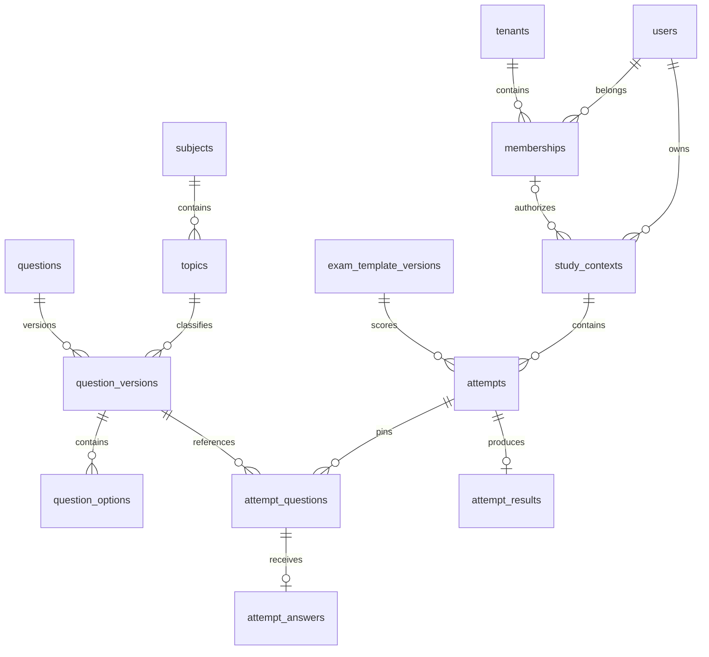

# Veritabanı tasarımı

## 27 Ekim 2026: e-posta doğrulama kodları

`2026_10_27_000001_create_email_verification_codes` migration'ı `email_verification_codes` tablosunu ekler. Her kullanıcı için tek satır: `user_id` UUID primary key ve `users` FK (ON DELETE CASCADE), `code_hash` (64 karakter HMAC-SHA256), `failed_attempts` (CHECK 0–5), `sent_at`, indeksli `expires_at` (`timestamptz`). Düz kod DB'de tutulmaz; özet kullanıcı kimliği + mevcut e-posta + kod ve uygulama anahtarına bağlıdır. Bildirim kuyruğu şifrelidir.

Kullanıcı satırı üzerinde kilit ile gönderim, hatalı tahmin sayımı ve tüketim sıralanır. Başarılı doğrulamada veya imzalı bağlantı doğrulandığında kod satırı silinir; yeniden gönderimde önceki kod geçersiz olur. Kullanıcı silindiğinde FK ile kod da silinir. Kodlar ve özetler hesap dışa aktarımına dahil edilmez. Ortak yerel `oggaq` veritabanına migration uygulanmadı; testler yalnız `oggaq_test` üzerinde çalıştı. Sunucu uygulaması [TESTING](TESTING.md) içinde kaydedilir.

Öğrenci süre tercihi migration'ı `2026_10_26_000003_add_student_exam_timer_choice`: `exam_attempts` tablosuna `timer_policy` (varsayılan `continuous`), `paused_at`, `paused_seconds` (varsayılan 0), `clock_seen_at`, `timer_session_id` ekler. Eski sütun değerleri/sonuçlar yeniden yazılmaz. `exam_timer_valid` ve genişletilmiş `exam_settings_valid`, sabit temel süre + kayıtlı ara toplamını doğrular; mevcut özgün soru, sonuç ve hesap silme korumaları aynı kalır. Süre tercihi değişmez. SQL'de keyfî deadline uzatma ve duraklayan kayda cevap reddedilir; sonuçtaki süre araları dışlar. Ayrıntılar [EXAMS](EXAMS.md) içinde. Ortak yerel DB'ye otomatik uygulanmaz.

26 Ekim 2026 cevap kilidi: `2026_10_26_000002_lock_submitted_exam_answers` yeni tablo/alan eklemeden `submitted_exam_answer_lock` trigger'ını kurar. Önceden null olmayan `exam_answers.selected_option_id` farklı bir seçenek veya null olamaz; aynı değer ve sonuç değerlendirmesinin `is_correct` yazması geçerlidir. Migration mevcut soru, cevap, sonuç ve kullanıcı satırlarını değiştirmez. Doğru yanıt aktif denemede kaynak anahtardan hesaplanarak yalnız cevaplanmış soruda gösterilir; toplam sonuç yine bitirmede kaydedilir. Migration yalnız test DB ve canlı API sunucusunda uygulandı; 19 iş tablosunun satırları değişmedi. Ortak yerel `oggaq` veritabanına uygulanmadı; bu hedef için kullanıcı onayı gerekir.

26 Ekim 2026 arşiv genişletmesi: 76–82. yenileme için mevcut modelde **14 tam seçenek + 77 ders şablonu** eklendi; güncel yenileme toplamı **46 tam + 253 ders** (76–98). 875 soru kaydında **368 yeni soru / 507 tekrar kullanılan sürüm** vardır. Dersler tam sınavla aynı sürümleri kullanır; kısmi derslere puanlama bağlantısı eklenmez. Yeni şema/migration yok; her dönem işleminde 19 tablonun eski satırları korundu. Gerçek aktarım yalnız canlı sunucudadır, yerel ortak içerik veritabanına yazılmadı. Ayrıntılar [EXAM_SOURCES](EXAM_SOURCES.md) içinde.

## Uygulanan eğitim ayrımı — 26 Ekim 2026

`official_exams.education_type`: NOT NULL, `basic|renewal` CHECK, varsayılan `basic`. Migration öncesi arşivin tamamı kullanıcı tarafından temel eğitim olarak doğrulandı; yeni alan varsayılanla eklenir, yayımlanmış soru/sınav içeriği veya geçmiş cevaplar değiştirilmez. Sınav tekilliği `(exam_type_id, education_type, year, term, exam_number, weapon_status, subject_id) NULLS NOT DISTINCT` olur. Tam sınavlar için eğitim/silah/yıl indeksi vardır. Ders ekranı eğitim türüne göre ayrılmaz.

Ertelenebilir `official_exam_education_guard` bağlı iki seçeneğin eğitim türünü; `official_exam_scoring_education_guard` puanlama döneminin eğitim türüyle eşleşmesini doğrular. Yayımlanmış künye değişmezliği önceki trigger ile korunur. Migration test DB'de doğrulandıktan sonra 26 Ekim 2026'da kullanıcı onayıyla yerel `oggaq` (127.0.0.1:55432) veritabanına uygulandı. 286 mevcut sınavın yeni alanı `basic`; iş verilerinin değişmediği transaction içinde özet karşılaştırmasıyla doğrulandı. 98. yenileme aktarımında sunucu `oggaq` DB'sine de uygulandı; eski 286 temel sınav korunarak iki yenileme seçeneği ve kendi puanlama dönemleri eklendi. Ardından 122. temelin 125/100 seçeneği eklendi: o aşamada sunucuda 288 temel kayıt ve iki 98. yenileme kaydı vardı; önceden var olan satırlar değiştirilmedi. Yerel geliştirme içerik DB'sine aktarım yapılmadı. Ayrıntılar [EXAM_SOURCES](EXAM_SOURCES.md) içinde. İki eğitimde aynı künye oluşmuşsa eski tekillik indeksine geri dönmek çakışmayı silmek yerine hata verir.

2024–2026 yenileme arşivi tamamlandıktan sonra 83–98 için **32 tam deneme + 176 ders şablonu**, 122. temel için iki tam denemeye ek **11 ders şablonu** vardır. Bu işlem yeni tablo/alan oluşturmaz; dersler `subject_id` ve `ogg-ders` türüyle mevcut `official_exams` modelini, tam sınavla aynı sabit `question_version_id` değerleriyle kullanır. Kısmi derslere `official_exam_scoring` eklenmez. 15 yeni tam kitapçıkta 819 yeni soru oluşturuldu ve 1.056 sürüm yeniden kullanıldı; önceden var olan satırlar her işlemde 19 tablo özetiyle korundu. Yerel geliştirme içeriğine aktarım yapılmadı.

Durum: `users`, `password_reset_tokens`, `sessions`, `personal_access_tokens`, `tenants`, `memberships`, `study_contexts`, `audit_events`; merkezi `subjects`, `topics`, `exam_types`, `question_sources`, `questions`, `question_versions`, `question_options`, `practice_attempts`, `exam_attempts`, `exam_answers` migration ile oluşturuldu. Laravel cache/jobs/batch/failed-job altyapı tabloları da vardır. İçerik görselleri, geçmiş sınavlar, resmî sınav şablonu/import/yönetişim/offline tabloları aşağıda **öneri** olarak anlatılır; henüz uygulanmadı. Alanlar İngilizce, zamanlar UTC `timestamptz`; API ISO 8601 döndürür. UUID kimlikler kullanılır. Yayımlanmış içerik fiziksel olarak güncellenmez; yeni sürüm eklenir.

Tek soru alıştırmasında sabit sürüm, selected option, sunucu sonucu ve bağlam `practice_attempts` içinde saklanır; composite FK/CHECK/trigger tamamlanmış sonucu korur. Ayrıntılar [STUDY](STUDY.md) içindedir.

## İlişkiler

## Kimlik ve üyelik

| Tablo | Temel alanlar ve kurallar |
| --- | --- |
| `users` | `id`, normalize `email` unique, `password`, `name`, `email_verified_at`, `platform_role`, `status` |
| `tenants` | `id`, `name`, `slug` unique, `status`, `branding` |
| `memberships` | `id`, `tenant_id`, `user_id`, `role`, `status`, `joined_at`, `revoked_at`; unique `(tenant_id,user_id)` ve `(id,tenant_id,user_id)` |
| `invitations` | `id`, `tenant_id`, `email`, hashlenmiş `token`, `role`, `expires_at`, `accepted_at`, `invited_by` |
| `study_contexts` | `id`, `user_id`, nullable `tenant_id`, nullable `membership_id`; kişisel veya şirket bağlamı |
| Oturum tabloları | Laravel oturum, parola sıfırlama ve Sanctum token tabloları; UUID kullanıcıya uyarlanacak |

`account_erasures(id, user_hash char(64) unique hex, erased_at)` silinmiş hesapların anahtarlı özetidir (HMAC-SHA256 ile kullanıcı kimliği; kimlik/e-posta yazılmaz); yalnızca ekleme kabul eder (`guard_account_erasure` tetikleyicisi güncelleme ve silmeyi reddeder) ve silme işlemiyle aynı transaction'da yazılır. Yedekten dönüşte `accounts:reapply-erasures` bu özetlerle eşleşen geri gelmiş kullanıcıları siler ([DEPLOYMENT](DEPLOYMENT.md) §17.4).

Hesap yaşam döngüsü ([PRIVACY](PRIVACY.md)): `users.pending_email` / `pending_email_requested_at` doğrulanmamış yeni adresi tutar (e-posta yalnızca imzalı bağlantı açılınca değişir); `personal_access_tokens.device_label` cihaz türü etiketidir. Hesap silme tek işlemde bağlı bütün satırları siler ve `exam_answers` DELETE ile `question_reports.note` temizleme korumalarını yalnızca işlem boyunca `oggaq.account_erasure = 'on'` ayarıyla (işlem sonunda `'off'`) kaldırır; `guard_exam_answer` ve `guard_question_report` aksi halde eskisi gibi çalışır. Kişiye bağlanan her yeni FK/kolon `AccountLifecycleTest` içindeki envantere eklenmeden test geçmez.

`study_contexts` CHECK kuralı: kişisel bağlamda `tenant_id` ve `membership_id` birlikte NULL; şirket bağlamında ikisi birlikte dolu. Şirket bağlamındaki `(membership_id,tenant_id,user_id)` üçlüsü `memberships` üzerinde composite FK taşır. Böylece farklı kullanıcının veya şirketin üyeliği bağlama atanamaz. Aktiflik FK ile garanti edilemez; transaction içinde üyelik yetkisi ayrıca kontrol edilir.

Kişisel bağlam için partial unique `(user_id) WHERE tenant_id IS NULL`; şirket bağlamı için `(user_id,tenant_id) WHERE tenant_id IS NOT NULL` kullanılır. NULL içeren sıradan unique index'in kişisel kayıt tekrarını önlediği varsayılmaz. Üyelik iptali kaydı silmez; geçmiş kayıtların bağlamı değişmez.

## Merkezi içerik

Uygulanan sürümün tam kapsamı [QUESTION_BANK](QUESTION_BANK.md) içindedir. `questions` tablosu `revision`, `latest_version_id`, `published_version_id` ve `created_by` taşır; pointer/soru bağları composite FK'dır. `question_versions` metin/açıklama, ders/konu/tür/kaynak, cevap seçeneği ve nullable `published_at` taşır. Her API düzenlemesi yeni sürüm oluşturur. Yayımlanmış sürüm ve seçenekleri PostgreSQL trigger'ları UPDATE/DELETE/sonradan seçenek INSERT işleminden korur. Public pointer yalnız yayımlanmış sürüme atanabilir. `audit_events.tenant_id` merkezi işlemler için NULL olabilir; kurum işlemleri gerçek tenant kimliğiyle kaydedilir.

Aşağıdaki tablo mevcut çekirdeği ve sonraki genişlemeleri birlikte gösterir. Kaynak hak inceleme durumu, dosya/görsel, içerik hash'i, sınav şablonu ve geçmiş sınav alanları henüz uygulanmadı; ilk kaynak modeli `title`, nullable `url` ve `citation` içerir. `exam_types` esnek `name`/unique `code` kataloğudur. Katalog API'si oluşturma/listeleme sunar; etiket güncelleme/silme yoktur.

| Tablo | Temel alanlar ve kurallar |
| --- | --- |
| `subjects` / `topics` | Ders/konu; `topics.subject_id` FK, `(id,subject_id)` unique |
| `question_sources` | Kaynak URL/dosya referansı, sınav yılı/dönemi, hak inceleme durumu ve belge özeti |
| `questions` | Kalıcı soru kimliği, yayın durumu, güncel yayın sürümü referansı |
| `question_versions` | `question_id`, `version`, `subject_id`, `topic_id`, metin/açıklama, kaynak, doğru seçenek referansı, içerik hash'i; unique `(question_id,version)` |
| `question_options` | `id`, `question_version_id`, `position`, `text`; unique `(question_version_id,position)` ve `(id,question_version_id)` |
| `question_assets` | `question_version_id`, private storage key, MIME, boyut, SHA-256 ve erişilebilir açıklama |
| `exam_templates` / `exam_template_versions` | Şablon kimliği, sürüm, tür, süre, soru/konu dağılımı, puanlama, geçme koşulu, `evaluator_version`, resmî kaynak/doğrulama durumu |
| `exams` / `exam_versions` / `exam_questions` | Geçmiş sınav kimliği/yılı/dönemi/türü/kaynağı; değişmez sınav tanım sürümü ve o sürümün soru listesi |

Merkezi içerik tabloları tenant bağımsızdır. Güncel yönergedeki gelecekteki kurum içerikleri ayrı sahiplik/yayın kapsamı gerektirir; bu sürümde merkezi tablolara tenant sahipliği eklenmedi ve merkezi havuza otomatik katılmaz. `(topic_id,subject_id)` composite FK ders/konu uyuşmazlığını engeller. Konu `parent_id` aynı derse composite FK ile bağlanır. Seçenek sayısı dört veya beşe sabitlenmez; API limiti 10'dur. Yayımlama en az iki seçenek, bir doğru seçenek, kaynak kaydı ve gerekli alanları doğrular; kaynak hak incelemesi ayrıca üretim kapısıdır.

Doğru seçenek `(correct_option_id,id)` üzerinden `question_options(id,question_version_id)` hedefine composite FK taşır; seçenek başka soru sürümünden olamaz. Taslakta doğru seçenek NULL olabilir; yayınlanmış sürümde NULL olmasını CHECK engeller. Döngüsel FK nedeniyle taslak sürüm oluşturma, seçenek ekleme ve yayınlama tek transaction içinde yapılır. Yayınlanmış sürümün metni, açıklaması, ders/konusu ve cevap anahtarı sabittir.

Bir soru birçok geçmiş sınavda kullanılabilir. `exam_versions` unique `(exam_id,version)`; `exam_questions` unique `(exam_version_id,position)` ve `(exam_version_id,question_version_id)` taşır. Kullanılmış sınav sırası/sürüm eşlemesi değiştirilecekse yeni tanım sürümü oluşturulur; geçmiş denemeler kendi `attempt_questions` listesini korur.

## Denemeler ve çalışma

| Tablo | Temel alanlar ve kurallar |
| --- | --- |
| `attempts` | UUID `id`, `context_id`, `mode`, optional `exam_version_id`, `template_version_id`, `status`, başlangıç/bitiş, `version`, `offline`, `verification_status`; unique `(id,context_id)` |
| `attempt_questions` | `id`, `attempt_id`, `question_version_id`, `position`; unique `(attempt_id,position)` ve `(id,attempt_id,question_version_id)` |
| `attempt_answers` | `attempt_id`, `attempt_question_id`, `question_version_id`, nullable `selected_option_id`, `version`; her deneme sorusuna bir cevap |
| `attempt_results` | unique `attempt_id`, doğru/yanlış/boş, puan/oran, elapsed, `evaluator_version`, kural hash'i ve ders bazlı sonuç snapshot'ı |
| `favorites` | `context_id`, `question_id`, `version`, `deleted_at`; unique `(context_id,question_id)` |
| `study_progress` | `context_id`, `subject_id`, sayımlar; unique `(context_id,subject_id)`; cevap/sonuçlardan yeniden üretilebilir projeksiyon |

`attempt_answers(attempt_question_id,attempt_id,question_version_id)` composite FK denemenin soru listesine; `(selected_option_id,question_version_id)` composite FK o sürümün seçeneklerine bağlanır. Boş cevap NULL'dır. Deneme sorusunun sürümü veya seçeneği karıştırılamaz. Şablon sürümü ve değerlendirme kodu sürümü korunur; kullanılan eski evaluator handler'ı yeni deploy'da silinmez. Tamamlanmış cevap/sonuçlar kullanıcı tarafından değiştirilemez.

Yanlışlar, kullanıcının yetkili bağlamındaki değerlendirilmiş cevaplardan üretilir; yeni çözüm eski deneme sonucunu değiştirmez. Bir yanlışın tekrar listeden çıkarılması davranışı Study modülünde son cevaba göre tanımlanır, geçmiş kaydı silmez. Favoriler soru kimliğine bağlıdır; eski deneme görüntülemesi ise soru sürümüne bağlıdır.

## Çevrimdışı, aktarım ve yönetişim

| Tablolar | Amaç |
| --- | --- |
| `question_packages`, `package_versions`, `package_items` | Değişmez manifest ve soru sürümü listesi; hash, sürüm ve delta |
| `sync_operations` | Kullanıcı, cihaz, bağlam, `operation_id`, payload hash, sonuç; unique `(user_id,operation_id)` |
| `change_events` | Commit sıralı cursor, kullanıcı/bağlam/varlık/sürüm, tombstone; yetkili artımlı indirme |
| `import_batches`, `import_rows` | Özel kaynak dosyası, inceleme/eşleme, satır durumu/hataları, onaylayan ve aktarım anahtarı |
| `legal_documents`, `user_acknowledgements`, `user_consents` | Metin sürümleri, aydınlatma kaydı, ayrı amaç bazlı rıza/geri çekme |
| `account_deletion_requests`, `audit_events` | Silme iş akışı ve hassas veri içermeyen işlem izi |

Değişiklik cursor'u sıradan transaction dışı sequence olarak uygulanmaz: önce sequence alan transaction geç commit ederse istemci bu kaydı atlayabilir. İlk sürümde transaction içinde kilitlenen bir cursor sayacı, domain yazımıyla birlikte commit sırasını korur; ölçek ölçümünde alternatif değerlendirilir. İşlem başına domain yazımı, idempotency sonucu, değişiklik olayı ve ilerleme güncellemesi aynı transaction içindedir.

Reklam için ertelenmiş model: `advertisers`, `campaigns` (başlangıç/bitiş, durum, optional tenant), `ad_slots`, `creatives`, `ad_metrics` (anonim toplu gösterim/tıklama). Öğrenci davranışıyla hedefleme veya reklam SDK'sı bu tasarımla otomatik olarak yetkilendirilmez.

## İndeksler, silme ve migration

- Üyelik `(user_id,status)`, `(tenant_id,status,role)`; deneme `(context_id,created_at,id)` ve `(context_id,status)`.
- Soru sürümü `(subject_id,topic_id)`; yayın listelemesi için sorguya uygun durum/kimlik indeksi; tüm FK referans kolonlarına ihtiyaçlarına göre indeks.
- Cevap ve paket ilişkilerinde parent/sıra; sync için kullanıcı/işlem unique ve `(user_id,context_id,cursor)` değişiklik indeksi.
- Soru metni hash'i mükerrer aday bulur; farklı kaynak ve görsel varyasyonlar yalnız hash ile kesin mükerrer sayılmaz.
- Yayınlanmış ve denemede kullanılan sürüm FK'ları `RESTRICT`; kullanıcı hesabı silme kontrollü purge/anonymize işidir. Soft delete tek başına KVKK veri imhası değildir.
- Migration sırası kimlik/tenant → bağlam → içerik/sürüm → şablon/sınav → deneme/cevap/sonuç → çalışma → offline/import/yönetişim olur.

Identity/Tenancy/QuestionBank FK/CHECK/unique, transaction ve yayımlanmış içerik trigger davranışları PostgreSQL integration testlerinde doğrulandı; henüz uygulanmamış modüller için aynı kontroller gerekecek. SQLite testleri merkezi veritabanı davranışının yerine kullanılamaz. Mevcut listeler sayfalıdır; gelecekteki raporlar sadece doğrulanmış bağlamdan filtrelenecek.

## Tekrar ve çıkmış sınav tabloları (uygulandı)

`official_exam_question_changes(id, official_exam_id, question_id, from_version_id, to_version_id, actor_id?, created_at)` yayımlanmış sınavdaki denetimli sürüm düzeltmelerinin kaydıdır; `guard_official_exam_question` trigger'ı yayımlanmış sınavda yalnız aynı sorunun daha yeni yayımlanmış sürümüne geçişe (sıra ve üyelik aynı) izin verir. `favorite_questions(study_context_id, question_id, created_at)`; PK `(study_context_id, question_id)`. `official_exams(id, exam_type_id, weapon_status?, subject_id?, source_id?, created_by?, title, year, term?, exam_number?, published_at?)` (`exam_type_id` Deneme/Ders; `weapon_status` armed/unarmed, türden ayrı; `subject_id` yalnız Ders sınavında; kimlik `(exam_type_id, year, term, exam_number, weapon_status, subject_id)` `NULLS NOT DISTINCT` tekildir) ve `official_exam_questions(official_exam_id, position, question_id, question_version_id)` — PK `(official_exam_id, position)`, unique `(official_exam_id, question_id)`, `(question_version_id, question_id)` composite FK. `exam_attempts.official_exam_id` (nullable FK) resmî denemeyi şablona bağlar; `exam_answers.changed_revision` cevap bazlı çakışma kontrolü içindir. Trigger'lar: yayımlanmış çıkmış sınav ve soruları değişmez; yayım için bitişik 1..N sıra gerekir; taslak sınav taslak soru sürümü sabitleyebilir ama yayımlanabilmesi için tüm sürümler yayımlanmış olmalıdır; sınav soru sınırı 200'dür (`official_exam_position_valid`, `exam_answer_position_valid`, `exam_settings_valid`); resmî deneme yayımlanmış şablonun tamamını (sayı, sıra, soru, sürüm) kopyalamak zorundadır ve `official_exam_id` sonradan değiştirilemez. Yukarıdaki `favorites`/`exams` tasarım tabloları bu uygulanmış şemayla değiştirilmiştir.

`question_reports(id, question_id, question_version_id, user_id?, exam_attempt_id?, reason, note?, status, resolved_by?, resolved_at?, resolution_note?, created_at)` öğrencinin biten bir denemede gördüğü soru hakkındaki bildirimidir. `question_version_id` öğrencinin gördüğü sürümü sabitler; soru sonradan düzeltilse de bildirim o sürüme aittir. `user_id`, `exam_attempt_id` ve `resolved_by` silinen kayıtta `SET NULL` olur: bildirim sorunun kaydıdır, kişinin değil; hesap silme bildirimi silmez, yalnız bağı koparır. CHECK: `reason` ∈ wrong_answer_key, typo, unclear, outdated, other; `status` ∈ open, fixed, dismissed; `note` ve `resolution_note` en çok 500 karakter; `status = 'open'` ⇔ `resolved_at IS NULL`. Kısmi unique indeks `question_reports_one_open (user_id, question_id) WHERE status = 'open'` öğrenci ve soru başına tek açık bildirim sağlar. `guard_question_report` trigger'ı bildirimin içeriğini (soru, sürüm, neden, not, tarih) değişmez kılar; bağlar yalnız NULL'a çekilebilir; kapanmış bildirim yeniden açılamaz ve çözüm notu değişemez. İndeksler `(status, question_id)` ve `(question_id, created_at)`. Audit: `question.reported` (hedef bildirim kimliği), `question_reports.fixed|dismissed` (hedef soru kimliği); not metni hiçbir log veya audit kaydına yazılmaz.

## Uygulanan süreli deneme ve mobil

[EXAMS](EXAMS.md) gerçek `exam_attempts`/`exam_answers` şemasını, yetki, sabit sürüm, revision, sunucu süresi ve değişmez sonucu anlatır. Önceki genel `attempts`/şablon/rapor tabloları gelecekteki tasarımdır. Expo istemcisinin native paket/test sınırları [MOBILE](MOBILE.md) içinde ayrıca raporlanır.

`import_batches` (kaynak SHA-256, eşleme hash'i, onay raporu, durum) ve `import_records` (kaynak sistem/tablo/anahtar → hedef kayıt, birincil anahtarı yeniden çalıştırmada çoğalmayı önler) içe aktarmayı izler; ayrıntı [IMPORTING](IMPORTING.md).

`exam_bookmarks(exam_attempt_id, position)` öğrencinin aktif sınavda son görüntülediği soru konumudur. `exam_attempt_id` PK ve `exam_attempts.id` için `CASCADE` FK'dır; `(exam_attempt_id, position)` aynı sınavın gerçek `exam_answers(exam_attempt_id, position)` unique çiftine `CASCADE` FK ile bağlıdır. Böylece mevcut olmayan bir soru konumu yazılamaz ve hesap/deneme/cevap silinince konum da silinir. Yeni denemede 1 kaydedilir, eski denemede satır yoksa API `resume_position=null` döndürür. Konum ayrı tabloda olduğundan cevap revision'ını ve değişmez soru/süre/sonuç ayarlarını değiştirmez. Ayrıntı [EXAMS](EXAMS.md#son-sorudan-devam-etme-24-ekim-2026).

## İş ilanları ve başvurular (uygulandı)

`job_postings` merkezi ilanları; `job_applications` kullanıcıya ait başvuruları saklar. Kullanıcı+ilan unique, durum/revision CHECK, kullanıcı silmede CASCADE ve ilan silmede RESTRICT FK ile korunur. Başvurunun iletişim/ön yazı alanları encrypted cast kullanır; `job_snapshot` başvuru anındaki ilan içeriğidir. Alanlar, indeksler, erişim ve migration ayrıntıları [JOBS](JOBS.md#yetki-ve-veri-modeli) içindedir. Başvurular çalışma/kurum bağlamından bağımsız kişisel veridir; hesap dışa aktarma ve silme kapsamındadır.

## Bağlı sınav seçenekleri (24 Ekim 2026, uygulandı)

`official_exams.generate_unarmed` boolean, varsayılan false; `derived_from_id` nullable UUID, aynı tablonun `id` alanına `RESTRICT` FK ve tekil indekstir. Ana silahlı kayıt bayrağı açar, otomatik oluşturulan silahsız kayıt ana kimliğe bağlanır. `official_exam_variant_shape` check kısıtı kendi kendine bağlantıyı, silahsız/derse özel ana kaydı ve türetilmiş kaydın tekrar ana kayıt olmasını engeller.

`official_exam_pair_complete` ve `official_exam_pair_questions` PostgreSQL constraint trigger'ları `DEFERRABLE INITIALLY DEFERRED` çalışır: transaction sonunda yayımlanmış ana kaydın 125, bağlı silahsız kaydın 100 sorusu olmalı; künye/kaynak eşleşmeli; ilk 100 soru, sıra ve sürüm aynı olmalıdır. Böylece ortak düzeltme iki şablona birlikte yazılabilir, tek tarafta bırakılan değişiklik commit edilemez. Mevcut yayımlanmış künye/sıra değişmezliği ve sürüm FK'ları korunur. Eski kayıtlar false/null ile kalır; otomatik içerik eşleştirme yapılmaz.

## Dönem bazlı ÖGG puanlama (24 Ekim 2026)

`scoring_rules` sürümlü merkezi kural/JSONB yapılandırması ve resmî kaynakları; `scoring_periods` eğitim+seçenek+numara tekilliğiyle tarih/kural eşleştirmesini; `official_exam_scoring` tam sınav metaveri bağlantısını taşır. `exam_score_results` kullanıcı ve isteğe bağlı deneme FK'larıyla kişisel, değişmez hesaplama sürümlerini saklar. Deneme+sürüm ve işlem kimlikleri tekildir; başlatmada seçilen kural geçmiş hesaplarda değişmez. Yayımlanmış kural ve hesap değişmezliği, çakışan kural aralıkları, kural/dönem tutarlılığı ve gerçek deneme cevabı sayıları PostgreSQL trigger'larıyla denetlenir. Hesap silme/export kapsamına alındı. Eski `correct_ratio_v1`, `score_percent`, sorular ve cevaplar değiştirilmez. Ayrıntılı alanlar/ilişkiler [EXAM_SCORING](EXAM_SCORING.md).

## Resmî sınav takvimi

`2026_10_26_000004_create_exam_calendar`, `exam_calendar_sources` (year PK, sabit EGM source_url, status, checked_at, verified_at, active_snapshot_id) ve `exam_calendar_snapshots` (UUID PK, year FK, unique year/content_hash, jsonb entries, created_at) tablolarını ekler. Kaynak, snapshot'ı aynı yıl üzerinden bileşik FK ile seçer. Snapshot UPDATE/DELETE PostgreSQL trigger'ı ile engellenir. Soru ve puanlama tablolarına bağlanmaz, mevcut kayıtları güncellemez. Ayrıntılar [EXAM_CALENDAR](EXAM_CALENDAR.md).
